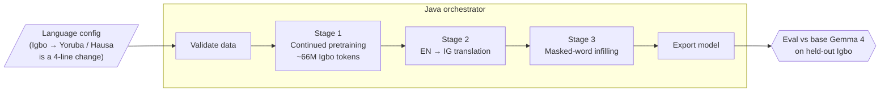

# Hey, I'm Mark

AI engineer & Java developer · Port Harcourt, Nigeria · Founder of **Spavecraft**

---

Most of my time goes into one question: **why do language models still struggle with the languages people around me actually speak?** I've been fine-tuning them on Igbo, and building tooling to make that repeatable for other Nigerian languages.

I also like knowing how things work underneath. When something feels like magic — tensors, memory allocation — I usually end up writing my own version just to understand it.

## Now: GemmaLingua

**[GemmaLingua](https://github.com/Mark12323/GemmaLingua)** teaches Google's Gemma 4 to read and write Igbo. Training is Python (PyTorch, Hugging Face, QLoRA on a single GPU); the pipeline around it is a Java orchestrator I wrote.

**Status:** training pipeline done · evaluation harness in progress — comparing fine-tuned vs. base on unseen Igbo text so the improvement is measured, not claimed.

<!-- When the eval lands, replace the line above with a small results table, e.g.
| Model | Perplexity ↓ | chrF (EN→IG) ↑ | Infill accuracy ↑ |
|---|---|---|---|
| Gemma 4 (base) | … | … | … |
| GemmaLingua | … | … | … |
-->

## Shipped

| Product | What it does |
|---|---|
| [**QuietInflame**](https://quietinflame.com) ·  | Healthcare navigation platform for people living with chronic inflammation. A provider directory built on official US registries (NPPES & CMS), plain-language condition guides, a personal care organizer and an AI Navigator assistant. |
| [**Craftviewpro**](https://github.com/Mark12323/Craftviewpro) | Enterprise surveillance network backend |

## Built to understand

| Project | What it is | What I learned |
|---|---|---|
| [**JTensor**](https://github.com/Mark12323/JTensor) | Dependency-free tensor library in plain Java | Strides, views, and why a reshape doesn't have to copy |
| [**Java-Arena**](https://github.com/Mark12323/Java-Arena) | Bump-pointer memory arena | Detecting use-after-reset — the hardest part to get right |

## Other work

| Project | Description |
|---|---|
| [debug.io](https://github.com/Mark12323/debug.io) | Debugging assistant built on Gemini |
| [Sent_analysis](https://github.com/Mark12323/Sent_analysis) | Sentiment analysis in Java |
| [ent_manager](https://github.com/Mark12323/ent_manager) | Enterprise management software |

Much of my client work at Spavecraft is private and doesn't show up here.

## Toolbox

  

## Activity

  <picture>
    <source media="(prefers-color-scheme: dark)" srcset="https://github-readme-stats.vercel.app/api?username=Mark12323&show_icons=true&hide_border=true&bg_color=0d1117&title_color=58a6ff&icon_color=58a6ff&text_color=c9d1d9" />
    
  </picture>
  <picture>
    <source media="(prefers-color-scheme: dark)" srcset="https://github-readme-stats.vercel.app/api/top-langs/?username=Mark12323&layout=compact&hide_border=true&bg_color=0d1117&title_color=58a6ff&text_color=c9d1d9" />
    
  </picture>

    

  <picture>
    <source media="(prefers-color-scheme: dark)" srcset="https://raw.githubusercontent.com/Mark12323/Mark12323/output/github-snake-dark.svg" />
    
  </picture>

---

  <b>Working on NLP for African languages?</b> I'd love to hear from you — reach out on
  <a href="https://www.linkedin.com/in/odike-mark-chinedu-51a0bb23a">LinkedIn</a> or
  <a href="https://x.com/mark_odike">X</a>.

